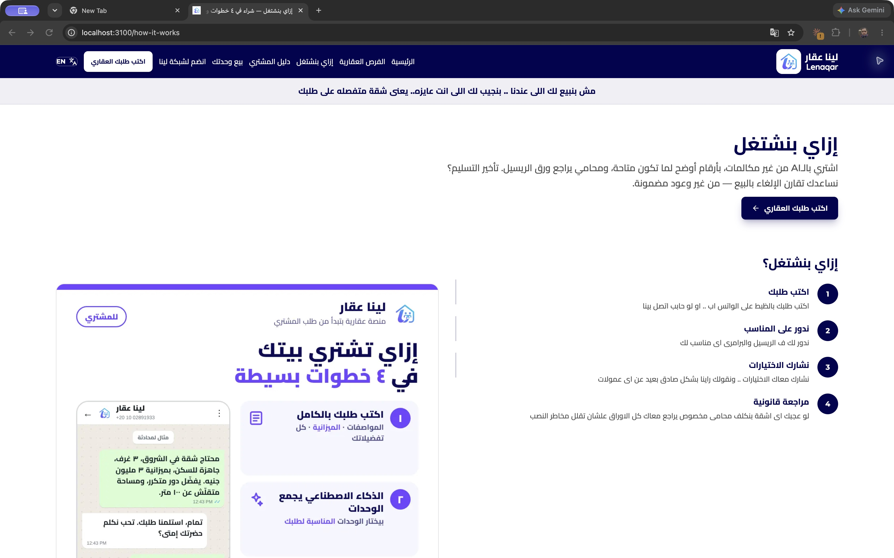
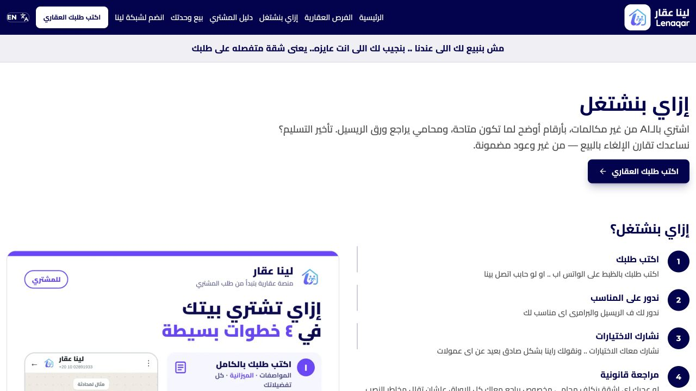
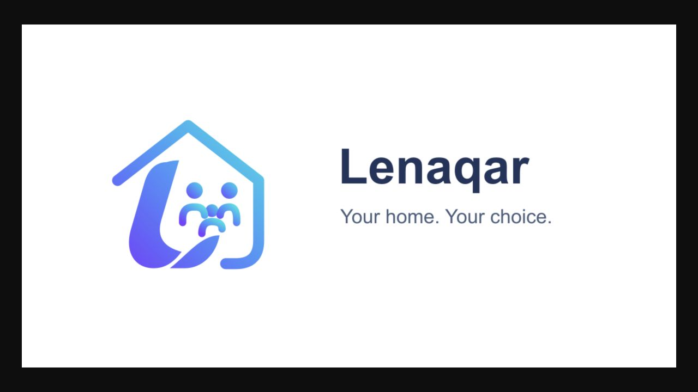

# Lenaqar Version 1 branding

The approved `lenaqar-v1.svg` is copied unchanged from the supplied artwork. All raster icons and the social composition are generated from that master by:

```sh
node scripts/generate-brand-assets.mjs
```

## Implementation

- Shared header and footer use the Version 1 icon, with a white background and unchanged aspect ratio. Adjacent brand text labels the links; duplicate icon images have empty alt text. The English wordmark is **Lenaqar**, and the footer and social card use **Your home. Your choice.**
- `src/config/brand.js` owns the versioned brand paths. Site/application/Open Graph names and Organization/WebSite metadata use Lenaqar, retaining the Arabic names, entity IDs, contacts, and publisher relationships.
- Root and route metadata use the 1200×630 social image. Listing photos remain the first choice for property previews; requests and listings without photos use the new fallback. Canonicals, Arabic localization, route copy, and privacy/noindex rules are preserved.
- Updated the two live buyer/seller instructional illustrations by compositing the approved SVG over their embedded old marks. Original illustrations are retained under `designs/lenaqar-icon/history/`; versioned production copies live with the new assets.
- Removed the obsolete `public/images/default_logo.jpg` and Next.js file-based `src/app/favicon.ico`. Explicit metadata now selects the versioned icons without a competing file-based declaration.
- Versioned assets cache immutably. Conventional `/favicon.ico`, `/favicon.svg`, and `/apple-touch-icon.png` aliases revalidate, avoiding the existing image proxy's year-long cache for unversioned aliases.
- There was no web manifest, maskable icon, or installation setup. The 192/512 PNG sizes are provided without adding PWA behavior. Customer, developer, partner, and other product artwork is unchanged.

## Generated assets

| Public path | Format / dimensions |
| --- | --- |
| `/brand/lenaqar-v1/lenaqar-v1.svg` | Original square SVG master and SVG favicon |
| `/brand/lenaqar-v1/favicon.ico` | Genuine ICO directory with 16, 32, 48px PNG frames |
| `/brand/lenaqar-v1/icon-96.png` | 96×96 PNG favicon |
| `/brand/lenaqar-v1/icon-180.png` | 180×180 PNG Apple touch icon |
| `/brand/lenaqar-v1/icon-192.png` | 192×192 PNG |
| `/brand/lenaqar-v1/icon-512.png` | 512×512 PNG / structured-data logo |
| `/brand/lenaqar-v1/social-preview.png` | 1200×630 PNG social composition |
| `/brand/lenaqar-v1/flow-buyer.png`, `/brand/lenaqar-v1/flow-seller-broker.png` | 1080×1350 PNG instructional illustrations |
| `/favicon.ico`, `/favicon.svg`, `/apple-touch-icon.png` | Conventional aliases |

## Verification

- Confirmed production apex `https://lenaqar.com` responds 308 to `https://www.lenaqar.com/`; the www homepage responds 200.
- The master is byte-for-byte identical to the approved source. Sharp validated all raster dimensions and formats; decoded all three ICO entries and verified their directory sizes and image sizes.
- `NEXT_PUBLIC_SITE_URL=https://www.lenaqar.com npm run build`: passed; 1,400 static pages generated. This explicit environment value overrides the checkout's local development hostname during verification. Build logs include existing oversized API cache entries and unavailable catalog-record warnings.
- `node --test src/lib/lenaqar/__tests__/*.test.js src/lib/__tests__/*.test.js`: 323 passed, zero failed.
- `npm run lint:all`: passed with 9 ESLint warnings and 11 SEO warnings, zero errors.
- Crawler-user-agent HTTP checks passed on ten routes: homepage, how-it-works, network login, guides index and article, buyer landing, projects index and detail, privacy, and private-match fallback. OG/Twitter titles match each route, image URLs are absolute www production URLs, dimensions are 1200×630, and private-match noindex/nofollow remains intact. A property-detail check confirms its original property photo is retained in both OG and Twitter previews.
- All twelve declared/alias/illustration asset URLs respond 200 with correct image content types, without authentication, on the local production server. Cache headers match their versioned or conventional roles.
- Browser QA passed at 1280px desktop and 375px mobile, with no mobile horizontal overflow. Chrome shows the new tab icon. The shared header, footer, and embedded illustration marks render the approved artwork.
- No references to `default_logo.jpg` remain in production source or public files. `git diff --check` passes.

## Screenshots








## Deployment and caching

This change is prepared as a pull request; production remains unchanged until deployment. Public asset responses and crawler metadata are checked against the local production build. Production firewall, CDN, search-engine, and social-platform recrawling cannot be guaranteed before deployment. Versioned paths avoid reuse of the old image URLs, while external services still decide when to refresh existing shared links.
